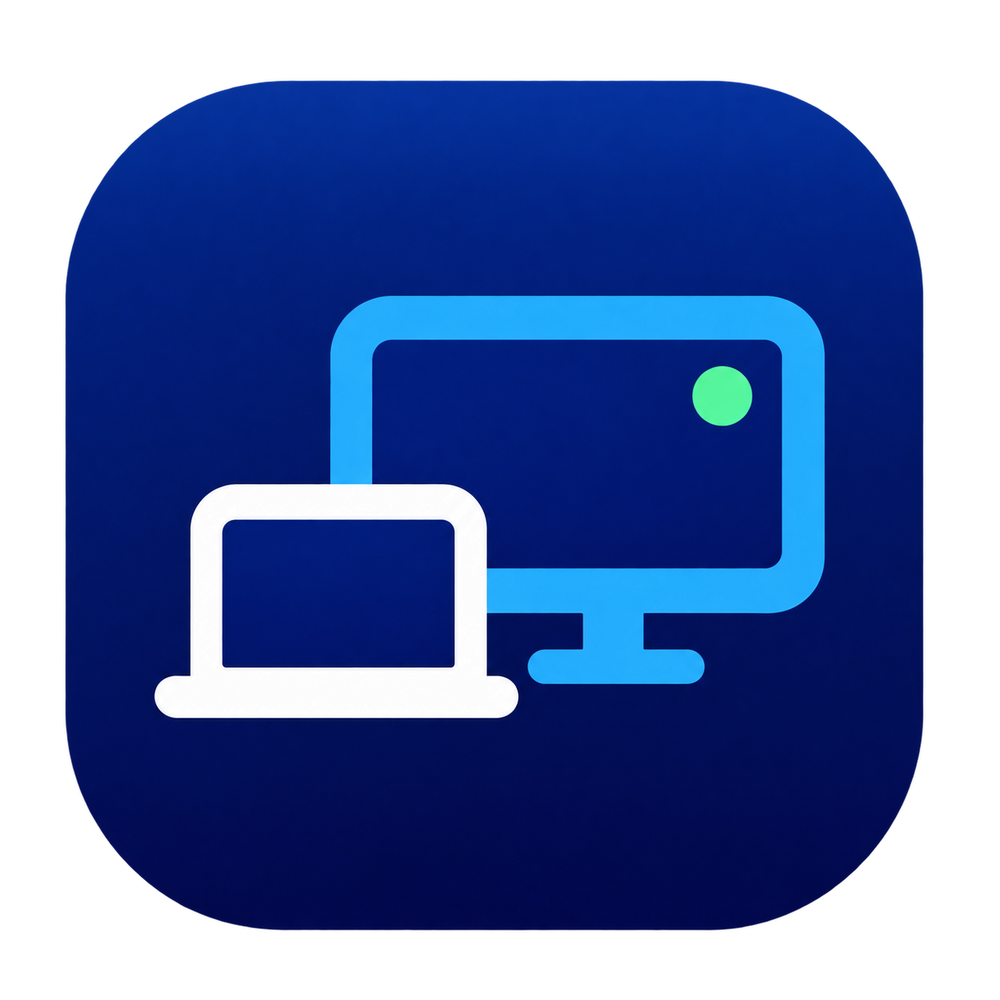

# 屏幕模式 · macOS 菜单栏应用



「屏幕模式」是一个 macOS 菜单栏工具。接上外屏后，可手动选择主屏，并让副屏扩展、镜像或关闭。

在 [GitHub Releases](https://github.com/SamonCloud/screen-modes/releases/latest) 下载 Apple 芯片版 ZIP。解压后把「屏幕模式.app」拖到「应用程序」，双击启动，再点屏幕顶部菜单栏的显示器图标。发布包经过本地签名，未做 Apple 公证。如果 macOS 阻止打开，可在「系统设置 → 隐私与安全性」中查看并允许打开这个应用。

接上外屏后，从菜单选一个模式：

| 预设 | 效果 |
| --- | --- |
| 内屏主屏 · 外屏扩展 | 内屏为主屏，外屏默认放在右边，两个屏幕显示独立桌面。 |
| 外屏主屏 · 关闭内屏 | 先使外屏成为主屏，确认它可用后把内屏从桌面布局中移除。窗口不会继续留在黑掉的内屏上。 |

在「配置模式」里选择「主屏」（内屏或外屏），再选择「副屏行为」（扩展、镜像或关闭）。选「扩展」时可以设置副屏位置。选「镜像」时，副屏显示主屏的内容。多台外屏同时在线时，系统优先沿用当前的外部主屏。若以外屏为主屏并选择关闭副屏，应用会关闭内屏。

所选模式在应用运行期间保持。内屏作为主屏或扩展屏时，macOS 合盖若停用内屏，菜单会显示等待开盖，开盖后重新应用。外屏主屏模式在开盖后会继续保持内屏关闭。在系统支持的合盖使用条件下，应用可以继续管理外屏；系统睡眠期间不会执行切换。

在「外屏主屏 · 关闭内屏」模式下，如果 MacBook 开盖，应用会在锁屏或进入休眠时先恢复内屏的可用状态。内屏可能短暂显示锁屏画面。若外屏仍连接，解锁并唤醒显示器后会重新应用所选模式。

最后一台外屏断开后，应用会清除当次选择并恢复内屏；如果已合盖，要等开盖后内屏才可用。再次插外屏时可以重新选模式。随时可点「恢复屏幕并交还系统管理」。已保存的预设不会因断开外屏或退出而消失。

如果希望每次登录都显示菜单栏图标，可以把应用放在「应用程序」文件夹，再打开菜单里的「登录时启动」。这会启动应用，显示模式仍由你手动选择。

软件关闭屏幕使用 macOS 私有显示接口，目前只在 Apple 芯片的构建中开放。程序不需要管理员权限、不修改睡眠设置。显示变更限于当前登录会话。若恢复内屏遇到系统拒绝，可先开盖并选择「恢复屏幕并交还系统管理」，或退出登录再登录。

```sh
./build.sh
./test.sh
```

从源码构建需要 macOS 12 或更新版本及 Xcode 命令行工具。构建脚本生成本机架构的应用并作本地签名。测试覆盖主屏切换顺序、镜像、合盖保留模式和断线复位。可在桌面会话下运行以下命令查看在线屏幕：

```sh
./build/屏幕模式.app/Contents/MacOS/ScreenModes --diagnose
```
